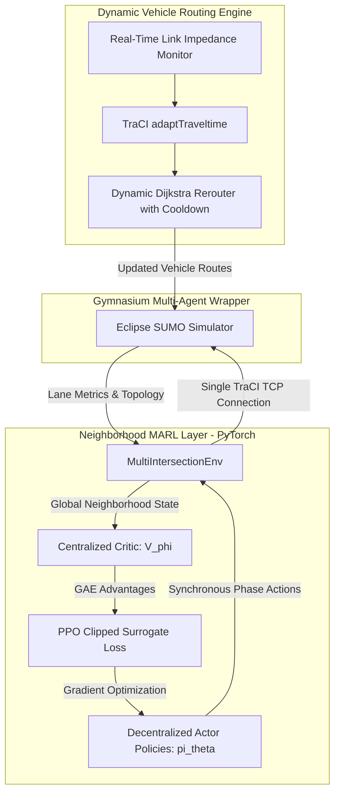

# Methodology: Cooperative Multi-Agent Deep Reinforcement Learning for Neighborhood Traffic Control

This document describes the formal mathematical formulation, multi-agent reinforcement learning architecture, and dynamic routing methodology of the **Neighborhood-Scale Adaptive Traffic Signal Control (ATSC)** framework.

---

## 1. Problem Statement & Research Motivation

Conventional urban traffic light management depends largely on static pre-timed plans (e.g., Webster's cycle optimization) or isolated sensor-actuated controllers. While effective for isolated junctions with stationary traffic demand, these systems fail across connected urban networks. 

When single-intersection reinforcement learning controllers optimize solely for their own local queue reduction, they inadvertently trigger **queue spillback**: flushing vehicles rapidly into downstream approach lanes creates severe gridlock at adjacent intersections.

To solve this, we formulate neighborhood traffic control as a **Decentralized Partially Observable Markov Decision Process (Dec-POMDP)**. Multiple communicating intersection agents learn cooperative signal timing policies using **Multi-Agent Proximal Policy Optimization (MAPPO)** with a **Centralized Critic**, synchronized with an online **Dynamic Vehicle Routing** layer.

---

## 2. System Architecture

The upgraded architecture comprises four core layers interacting across a shared microscopic simulation:

---

## 3. Dec-POMDP Mathematical Formulation

The neighborhood intersection network is formulated as:
$$\langle \mathcal{N}, \mathcal{S}, \{\mathcal{A}_i\}, \mathcal{P}, \{\mathcal{R}_i\}, \Omega, \{\mathcal{O}_i\}, \gamma \rangle$$

### 3.1 Agents ($\mathcal{N}$)
A set of $N$ intersection controllers $\mathcal{N} = \{1, 2, \dots, N\}$. In our standard urban benchmark, $N = 16$ arranged in a $4 \times 4$ arterial grid.

### 3.2 State & Observation Space ($\mathcal{O}_i$)
Each intersection agent $i$ observes a continuous vector $s_i \in \mathbb{R}^{38}$ comprising two components:

1. **Local Lane Features** (for each controlled approach lane $l$):
   - **Normalized Queue Length**:
     $$q_i^l = \min\left(1.0, \frac{\text{HaltingVehicles}_l}{\text{LaneLength}_l / 7.5}\right)$$
   - **Normalized Vehicle Density**:
     $$d_i^l = \min\left(1.0, \frac{\text{TotalVehicles}_l}{\text{LaneLength}_l / 7.5}\right)$$
   - **Normalized Mean Speed**:
     $$v_i^l = \min\left(1.0, \frac{\text{MeanSpeed}_l}{\text{SpeedLimit}_l}\right)$$
   - **Current Signal Phase**: One-hot representation of active green phase.

2. **1-Hop Neighbor Context**:
   For each adjacent neighbor $j \in \mathcal{N}(i)$ determined from the road network topology graph:
   $$s_i^{neighbor} = \bigoplus_{j \in \mathcal{N}(i)} \left[ \bar{q}_j, \bar{d}_j, \frac{\phi_j}{K-1} \right]$$
   Zero-padding is applied for boundary intersections to ensure uniform input dimensions.

### 3.3 Action Space ($\mathcal{A}_i$)
Each agent selects from discrete non-conflicting green phases:
- **Action 0**: North-South Green (Phase 0)
- **Action 1**: East-West Green (Phase 2)

#### Yellow Transition Phase Enforcement
To adhere to realistic traffic engineering and vehicle deceleration dynamics, whenever an agent switches its active green phase, an automatic **4-second Yellow phase** is executed before the target green phase activates.

### 3.4 Cooperative Reward Formulation ($\mathcal{R}_i$)
To align individual intersection efficiency with neighborhood-wide congestion relief, agents optimize a **Shared Cooperative Reward**:
$$R_i(t) = \alpha R_{local, i}(t) + (1 - \alpha) \frac{1}{|\mathcal{N}(i)|} \sum_{j \in \mathcal{N}(i)} R_{local, j}(t)$$

Where:
$$R_{local, i}(t) = -\sum_{l \in \mathcal{L}_i} \left( \text{HaltingVehicles}_l(t) + 0.05 \cdot \text{WaitingTime}_l(t) \right)$$
The parameter $\alpha \in [0, 1]$ tunes the balance between local throughput and neighborhood coordination (default $\alpha = 0.5$).

---

## 4. Multi-Agent Reinforcement Learning (MAPPO)

To address the non-stationarity inherent in multi-agent environments (where simultaneous policy updates destabilize individual agent value predictions), we utilize **Centralized Training with Decentralized Execution (CTDE)**:

1. **Decentralized Actor Network ($\pi_\theta$)**:
   - Takes local + neighbor observation $s_i \in \mathbb{R}^{38}$.
   - Fully connected MLP ($[128, 128]$ hidden units with Tanh activation).
   - Outputs categorical distribution over discrete green phases.

2. **Centralized Critic Network ($V_\phi$)**:
   - Takes the concatenated global state vector $S = [s_1, s_2, \dots, s_N] \in \mathbb{R}^{38 \times N}$.
   - Fully connected MLP ($[256, 128]$ hidden units with Tanh activation).
   - Predicts global scalar value function $V_\phi(S)$.

3. **Generalized Advantage Estimation (GAE)**:
   $$\hat{A}_t = \sum_{l=0}^\infty (\gamma \lambda)^l \delta_{t+l}^V, \quad \delta_t^V = r_t + \gamma V_\phi(S_{t+1}) - V_\phi(S_t)$$

4. **PPO Clipped Objective**:
   $$L^{CLIP}(\theta) = \hat{\mathbb{E}}_t \left[ \min\left(r_t(\theta)\hat{A}_t, \, \text{clip}(r_t(\theta), 1-\epsilon, 1+\epsilon)\hat{A}_t\right) \right]$$

---

## 5. Dynamic Vehicle Routing Engine

Operating in parallel with signal control, the dynamic router updates SUMO's travel-time impedance model via TraCI:

$$\text{Impedance}(e) = \frac{\text{Length}(e)}{\max(1.0, \bar{v}_e)} + 2.0 \cdot \text{HaltingVehicles}(e)$$

- Every $\Delta t_{route} = 15$ seconds, updated edge impedances are broadcast via `traci.edge.adaptTraveltime()`.
- En-route vehicles whose current speed drops below 50% of the speed limit are rerouted via `traci.vehicle.rerouteTraveltime()`.
- A **30-second per-vehicle cooldown** is enforced to eliminate route oscillation and high-frequency path thrashing.

---

## 6. Evaluation Metrics & Standards

The framework computes standardized performance indicators:
1. **Average Travel Time & Delay**: Extracted from tripinfo XML output.
2. **Time Saved per Vehicle**:
   $$\Delta T = \bar{W}_{Fixed} - \bar{W}_{MAPPO} \quad (\text{seconds/veh})$$
3. **Total Person-Hours Saved**:
   $$T_{saved} = \frac{\Delta T \times N_{arrived}}{3600} \quad (\text{hours})$$
4. **Vehicular Emissions Abatement**: Calculated using SUMO's HBEFA3 standard for CO₂ (kg) and Fuel (liters).
5. **Jain's Fairness Index**:
   $$F = \frac{\left(\sum_{i=1}^N W_i\right)^2}{N \sum_{i=1}^N W_i^2}$$
